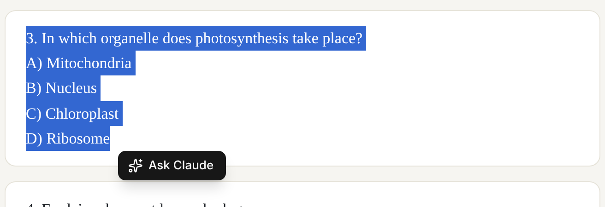
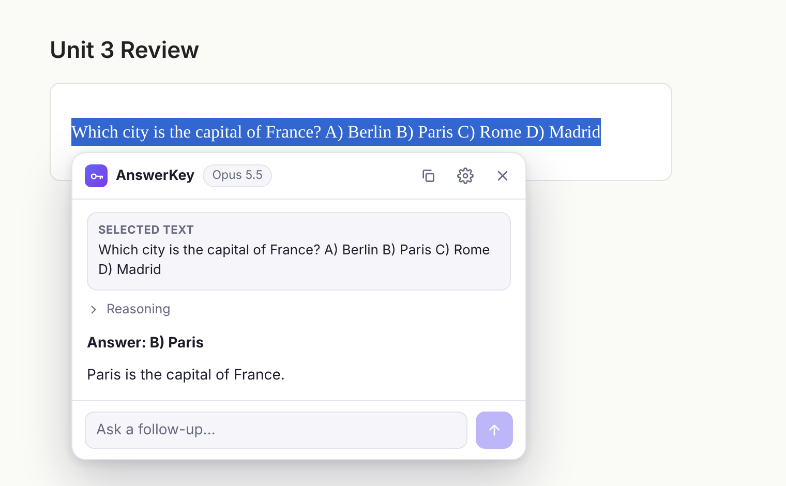

# AnswerKey – Ask Claude (Microsoft Edge extension)

Select text on any web page, click **Ask Claude**, and Claude's answer streams into a small panel next to the
text. AnswerKey uses **your own Anthropic API key**, so there is no account, server or subscription in between.

| Select text | Get the answer |
| --- | --- |
|  |  |

## Features

- **Three ways to ask:** the floating **Ask Claude** button that appears when you select text (mouse or
  keyboard), the right-click menu (**Ask Claude about "…"**), or the keyboard shortcut **Alt+Shift+K**.
- **Answers first.** For a multiple-choice question you get the option letter and text first, then a short
  explanation. Several questions in one selection are answered in order. Text that isn't a question gets explained.
- **Streaming,** with an expandable summary of Claude's reasoning while it thinks.
- **Follow-up questions** in the same panel, plus **Stop**, **Retry** and **Copy**.
- Works in text boxes and iframes. On pages extensions can't change (browser pages, the PDF viewer, the
  add-ons store), the answer opens in its own small window instead.
- **Toolbar popup:** type a question directly, or turn the button off everywhere or just on the current site.
- **Settings:** model, thinking effort, your own standing instructions (for example "Answer with just the
  letter" or "Reply in Hindi"), and whether to include the page title and site name for context.
- Light and dark themes, following your system setting.

## Install

### From a release (no build tools needed)

1. Open the [latest release](https://github.com/kawincodes/answerkey-ext/releases/latest) and, under
   **Assets**, download **answerkey-edge-v….zip** (not "Source code").
2. Extract it to a folder you'll keep, for example `Documents\AnswerKey` (right-click the zip →
   **Extract All…**). Edge runs the extension from this folder, so don't delete or move it.
3. Open `edge://extensions` in Microsoft Edge and turn on **Developer mode** (left sidebar, or the toggle
   at the bottom).
4. Click **Load unpacked** and select the extracted folder (the one that contains `manifest.json`).
5. The AnswerKey settings page opens. Paste your API key and click **Save key**. AnswerKey checks the key
   right away. Create a key in the [Claude Console](https://platform.claude.com/settings/keys) if you don't
   have one.
6. Reload tabs that were already open, so the **Ask Claude** button can appear in them.

It also works in Google Chrome and other Chromium browsers (`chrome://extensions` → **Load unpacked**).

**Updating:** download the new zip, extract it into the same folder (replacing the old files), and click the
reload icon on the AnswerKey card in `edge://extensions`. Your key and settings are kept. Loading it from a
different folder installs a separate copy, and you'd have to enter your key again.

Edge may warn about extensions in developer mode when it starts; that's expected for extensions installed
this way.

### From source

You need [Node.js](https://nodejs.org/) 20 or newer.

```bash
npm install
npm run build
```

This creates the `dist/` folder, which is the extension. Load it with **Load unpacked** as in steps 3–6
above, choosing the `dist` folder.

After changing the code, run `npm run build` again and click the reload icon on the AnswerKey card in
`edge://extensions`.

## Using it

1. Select a question on any page. Include the answer choices in the selection.
2. Click **Ask Claude**, right-click and choose **Ask Claude about "…"**, or press **Alt+Shift+K**.
3. Read the answer. Type a follow-up in the box at the bottom, or press **Esc** to close the panel.
   Drag the panel by its header if it covers something.

To change the shortcut, open `edge://extensions/shortcuts` (or click **Change shortcut** in AnswerKey's settings).

## Settings

| Setting | Default | Notes |
| --- | --- | --- |
| Model | Claude Opus 5.5 | Sonnet 5.5 is faster and cheaper, Haiku 5.5 is the fastest and cheapest, Fable 5.1 is the most capable and most expensive. |
| Thinking effort | Medium | Lower is faster and cheaper; higher helps on hard problems. |
| Your instructions | empty | Added to every new question, for example "Answer with just the option letter." |
| Ask Claude button | on | Can also be hidden per site from the toolbar popup. |
| Send page title and site name | on | Helps with context such as the course or quiz name. The full URL is never sent. |

A conversation keeps the model and settings it started with. Changes apply to the next question you start.

## Cost

Requests are billed to your Anthropic account at normal [API prices](https://www.anthropic.com/pricing#api).
Each question sends the selected text and a short system prompt (about 400 tokens), and Claude's thinking
counts as output. To spend less, pick a smaller model or a lower thinking effort, and use **Stop** if an answer
is going somewhere you don't need: stopping cancels the request, so you aren't billed for the rest.

## Privacy and security

- **Your key stays in your browser.** It is stored in `chrome.storage.local` for this browser profile only,
  never synced, and the extension restricts that storage to its own pages. Content scripts running inside web
  pages can't read it, and the key is sent only to `api.anthropic.com`.
- **What is sent, and when.** Only when you ask a question: the selected text, the page title and site name
  (if enabled), and your follow-up messages. They go to Anthropic's API and nowhere else. AnswerKey has no
  server and no analytics.
- **Page isolation.** The button and panel live in a closed shadow DOM, so pages can't read or restyle them.
  Answers are rendered from Markdown through a strict allow-list sanitizer (no images, scripts, iframes, forms
  or inline styles), so text on a page can't use an answer to load remote content.
- **Calling the API from the browser.** The Anthropic SDK refuses to run in browsers unless you pass
  `dangerouslyAllowBrowser: true`, because a key embedded in a website is visible to every visitor. That
  doesn't apply here: each user enters their own key. Never build a copy of this extension with a key baked in.

Be aware that selected text can contain instructions written for AI assistants. AnswerKey tells Claude to
point such text out rather than follow it, but treat answers with the usual care.

## How it works

```
web page ── content script ──(Port: question / streamed answer)── background service worker ── Anthropic API
             src/content/                                         src/background/
             floating button, selection,                          @anthropic-ai/sdk, streaming,
             panel in a closed shadow DOM                         conversation history, menus, shortcut
```

- **`src/background/`** is the extension service worker. It calls the Messages API with the official
  TypeScript SDK (`client.beta.messages.stream`) using adaptive thinking with summarized display, the effort
  you chose, and `max_tokens` of 64,000. Each panel is one conversation, stored in `chrome.storage.session`
  so a follow-up resends the exact same history, which keeps Claude's thinking blocks valid.
- **Refusal fallback is on.** Requests include `fallbacks: "default"` (beta `server-side-fallback-2026-07-01`).
  If a model's safety classifier declines a question, the API re-runs it on the fallback model Anthropic
  recommends for that case, and the panel says so. To turn this off, remove the `betas` and `fallbacks` lines
  in `src/background/claude.ts`.
- **`src/content/`** watches for selections, shows the floating button, and mounts the answer panel.
- **`src/ui/`** has the answer panel (shared by the in-page panel and the stand-alone answer window),
  Markdown rendering and styles.
- **`src/pages/`** has the settings page, toolbar popup and answer window.
- **`src/shared/`** has the settings, model list and message protocol shared by all of the above.

## Development

| Command | What it does |
| --- | --- |
| `npm run build` | Production build into `dist/` (minified). |
| `npm run watch` | Rebuilds on every change, unminified with source maps. |
| `npm run typecheck` | Type-checks all TypeScript. |
| `npm run zip` | Builds `answerkey-edge-v<version>.zip`, the file attached to GitHub releases and uploaded to the Edge Add-ons store. |
| `npm run test:e2e` | End-to-end test (see below). |

**End-to-end test.** `tests/e2e.cjs` loads `dist/` into Chromium with Playwright, points `api.anthropic.com` at
a local mock server that streams real server-sent events (`tests/mock-api.cjs`), and drives the extension with
real mouse selections. It covers the settings page and key check, the request sent to the API, streaming,
follow-ups and replayed thinking blocks, Stop, Retry, refusals, mid-answer fallbacks, cut-off answers, API
errors, iframes, text areas, per-site toggles, the popup and the answer window, and that web pages and
content scripts can't read the stored key. It needs Playwright with Chromium and the `openssl` command:

```bash
npm install --no-save playwright
npx playwright install chromium
npm run test:e2e
```

Screenshots from the run are saved in `tests/out/`.

## Releasing a new version on GitHub

Releases are built and published by GitHub Actions (`.github/workflows/release.yml`).

1. Set the new `version` in `package.json` (for example `1.0.1`; it is copied into the manifest) and push
   the commit.
2. Push a matching tag:

   ```bash
   git tag v1.0.1
   git push origin v1.0.1
   ```

   Or open **Actions → Release → Run workflow** on GitHub, which releases the version in `package.json` from
   the branch you pick and creates the tag for you.

The workflow type-checks, builds the zip, runs the end-to-end test against the unpacked zip (exactly what
users install), and publishes a release with the zip, its SHA-256 checksum, and the install steps from
`.github/release-notes.md` followed by GitHub's list of changes since the last release. It refuses to run if
the tag and `package.json` disagree or the release already exists.

## Publishing to the Edge Add-ons store

1. Bump `version` in `package.json` (it is copied into the manifest), then run `npm run zip`.
2. In [Microsoft Partner Center](https://partner.microsoft.com/dashboard/microsoftedge/overview), create a new
   extension and upload the zip.
3. In the listing, explain that the extension sends the text the user selects to Anthropic's API with the
   user's own key, and link a privacy policy that says so.

## Troubleshooting

- **The button doesn't appear.** Reload the tab (tabs opened before installing need this). Check that the
  button isn't turned off for the site in the toolbar popup. Some sites block text selection.
- **"Anthropic rejected your API key."** Check the key in settings and that your Anthropic account has credit.
- **"The model … isn't available to your API key."** Pick another model in settings.
- **PDFs and browser pages.** Right-click the selection or press the shortcut; the answer opens in its own window.

AnswerKey is a reading and study aid. Follow the rules of any course, exam or site you use it on.
